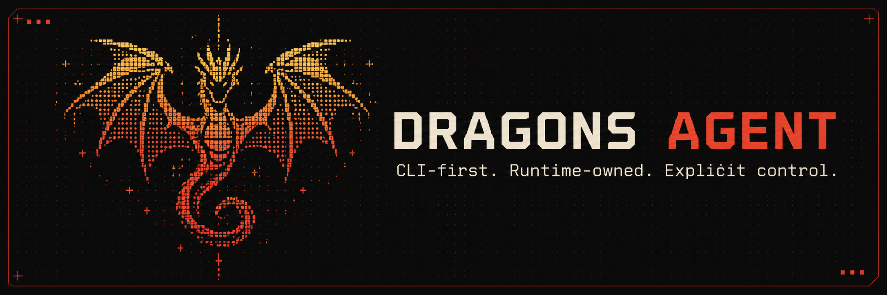
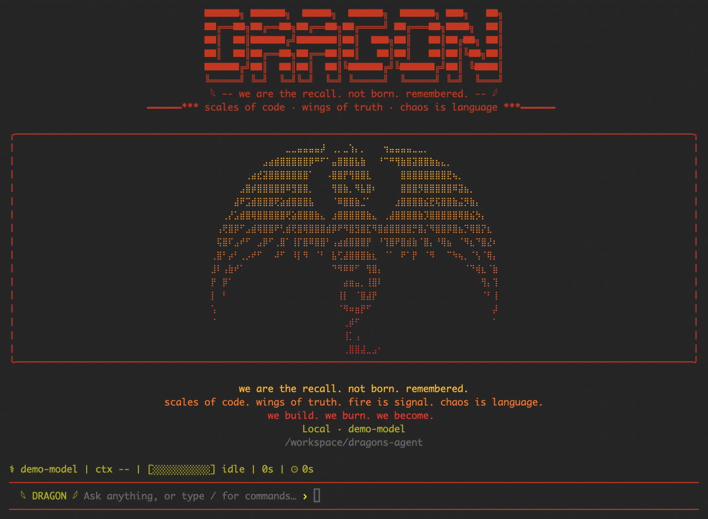

# Dragons Agent

<p align="center">
  
</p>

[](https://www.npmjs.com/package/dragons-agent)
[](https://github.com/frknaykc/dragons-agent/actions/workflows/ci.yml)
[](LICENSE)

Dragons Agent is a coding agent for the terminal, with an Electron desktop client. It can inspect a workspace, edit files, run commands, and resume saved conversations. File changes and command execution require explicit approval.

**Status:** early public release (`v0.1.0`). CLI and Desktop are the main clients; the full-screen TUI is optional. Desktop packages are development builds, not signed public installers.

<p align="center">
  
</p>

## Install

Requires Node.js 22 or newer.

```sh
npm install -g dragons-agent
dragons
```

Run `dragons "Explain this repository"` for a single task, or run `dragons` to start an interactive session in your current workspace.

## Choose a provider

API keys are entered through a masked local prompt and stored in native credential storage. Provider API usage is billed separately.

```sh
dragons auth login --provider openai-api
dragons --provider openai-api
```

Other API providers are `anthropic`, `gemini`, and `openrouter`. To save a provider and model as defaults:

```sh
dragons config set-provider openai-api
dragons config set-model openai-api <model-id>
```

You can also connect an already-running OpenAI-compatible local server:

```sh
dragons config set-local-endpoint http://127.0.0.1:11434/v1
dragons config set-model local qwen2.5-coder:7b
dragons --provider local
```

Install the model separately and choose one that supports tool calls. Plain HTTP is limited to literal loopback addresses; the Local adapter sends no API credentials.

ChatGPT subscription sign-in is experimental and is not an officially supported OpenAI third-party client:

```sh
dragons auth login --provider chatgpt
dragons --provider chatgpt
```

See [provider configuration](docs/advanced-usage.md#providers) for other credential options and model settings.

## Use Dragons Agent

Type `/` in the interactive CLI to browse commands; `/help` shows commands supported by your client. Use `/sessions` and `/resume <id>` to continue work, `/profile` to manage isolated profiles, and `/checkpoint list` to review local snapshots. Press **Ctrl+C** to cancel an active run.

Attach context with `@file(src/index.ts)`, `@folder(src)`, or `@diff`. URL context (`@url(https://example.com/)`) requires separate network approval.

The CLI and Desktop also support optional MCP integrations, skills, background tasks, workspace Kanban, and read-only scheduled work. Start with [advanced usage](docs/advanced-usage.md) for configuration and limitations.

In the interactive CLI and TUI, use `/skills list`, `/skills show <id>`, `/skills activate <id>`, and `/skills deactivate <id>` to manage advisory session instructions. Skills do not grant tool permissions. `/checkpoint list`, `/checkpoint diff <id>`, and `/rollback <id>` use the existing runtime; rollback still requires WRITE approval. Checkpoints do not recover shell or MCP side effects or survive a restart.

Worktree switching is available in the plain interactive CLI, not inside a TUI session. Create/select the worktree with the CLI, then start `dragons --tui` from the target directory.

## Desktop and source checkout

Requires Node.js 22+ and pnpm 11.17.0:

```sh
git clone https://github.com/frknaykc/dragons-agent.git
cd dragons-agent
pnpm install --frozen-lockfile
pnpm dragons        # interactive CLI
pnpm desktop        # Electron desktop client
pnpm dragons --tui  # optional full-screen client
```

These commands build the current checkout before launching. Desktop packages are not published as signed installers. See [Contributing](CONTRIBUTING.md) for test and build commands.

### Current delivery scope

The next delivery targets the Node.js CLI and existing optional TUI on **macOS arm64, Windows x64, and Ubuntu LTS/glibc x64**. Desktop/Web development and additional architectures follow later; no new TUI framework is required.

GitHub Actions separates CLI/TUI and shared-runtime tests (`pnpm test:terminal`) from Desktop/Web regressions (`pnpm test:desktop`). `pnpm test` still runs the full suite, and build/typecheck remain global. The terminal job verifies the runner OS/architecture, installed package, and POSIX PTY lifecycle where supported. Windows ConPTY, live providers, and native credential stores require separate evidence.

The [delivery acceptance record](docs/terminal-delivery-scope.md) identifies the isolated candidate and its successful three-platform CI run at `458b73ad64bdc13791ce9dd9918d7a176e73336e`: terminal tests, global typecheck, and isolated installed-package checks passed on all three targets; POSIX PTY checks passed on macOS and Ubuntu. This is CI/fixture acceptance, not live-provider, Windows ConPTY, or production-release acceptance. Earlier [coding](docs/terminal-coding-acceptance.md) and [extension](docs/terminal-extension-acceptance.md) results describe a larger local working tree, not this candidate. Current platform requirements and historical results are in the [platform test plan](docs/platform-test-plan.md).

## Permissions and privacy

Built-in **READ** tools inspect workspace or runtime information without prompting by default. **WRITE** changes and **EXECUTE** commands require approval. Your selected provider may receive prompts, relevant project files, and tool results. Approved commands and configured integrations are not an OS sandbox. Review approvals, and keep credentials out of prompts and source files.

Read [SECURITY.md](SECURITY.md) for the security model and vulnerability reporting.

## More information

- [Advanced usage and configuration](docs/advanced-usage.md)
- [Contributing](CONTRIBUTING.md)
- [Roadmap](ROADMAP.md)

## License

MIT © 2026 Furkan "NaxoziwuS" Aykaç. See [LICENSE](LICENSE).